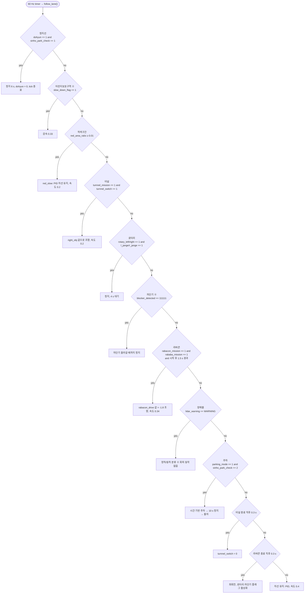

# 2024 Autorace
Co-Show 2024 Autorace 1/10 Scale 자율주행 경진대회 출전 코드입니다.

## Hardware

| 항목 | 값 |
|---|---|
| 플랫폼 | MIT racecar-v2 (F1TENTH 계열) |
| 구동 | `AckermannDriveStamped` |
| LiDAR | Slamtec RPLIDAR (2D, `/scan`) |
| 카메라 | USB 카메라 640×480, **어안(equidistant) Calibration** |
| IMU | Razor 9-DoF |
| 온보드 PC | Intel NUC11, ROS 1 Noetic |

## Packages

| 패키지 | 역할 |
|---|---|
| **`daecar`** | 2024년 재작업본, 주력. 진입점은 `scripts/main_20.py` |
| `wego` | 텔레옵 + rviz 센서 뷰 |
| `limo_marker` | AR 마커 실습 8단계 (구독 → 정지 → 거리 → 각도 → ID → 추종 → 통합) |

### `daecar` 내부 구성

| 파일 | 역할 |
|---|---|
| `scripts/SlideWindow.py` | 버드아이 뷰 변환 → 히스토그램 피크 → **30윈도우 슬라이딩 차선 탐색** → polyfit → 차선 중심 |
| `scripts/HSV.py`, `HSVtest.py` | HSV 임계값 튜너. 흰 차선 `[0,0,140]`, 적색 구간 면적비(`red_area_ratio`) 검출 |
| `scripts/my_detect_obs.py` | `/scan` 각도 섹터링 → `lidar_warning`, `static_or_dynamic`, `light_obj`, `right_obj`, 차단기 검출(`blocker_status`, 3프레임 디바운스) |
| `scripts/rabacon_drive.py` | `obstacle_detector` 의 `/raw_obstacles` 원형 군집을 좌우 ±1.2m 로 분리 → 라바콘 슬라럼 조향값 발행 |
| `scripts/child_sign.py` | `/ar_pose_marker` (ar_track_alvar) 구독 → `sign_id` 발행. 마커 ID 로 차선 선택 |
| `scripts/main_20.py` | 우선순위 상태기계 + PID 조향. 정지선 → 어린이보호구역 감속 → 적색구간 감속 → 터널 → 로터리 양보 → 차단기 → 라바콘 → 정적/동적 장애물 → 주차 → 차선 유지 (아래 다이어그램 참조) |

측위(localization) 모듈은 없습니다. SLAM 도 odom 융합도 맵도 쓰지 않는 **순수 반응형** 구조입니다.

## ROS topics

세 패키지의 `rospy.Publisher` / `rospy.Subscriber` 중 주석 처리되지 않은 것만 모았습니다. `wego` 는 launch · rviz 설정만 있고 Python 노드가 없습니다.

| 토픽 | 메시지 타입 | Publisher | Subscriber |
|---|---|---|---|
| `/scan` | `sensor_msgs/LaserScan` | RPLIDAR 드라이버 (외부) | `daecar/my_detect_obs.py` |
| `/raw_obstacles` | `obstacle_detector/Obstacles` | `obstacle_detector` 노드렛 (외부) | `daecar/rabacon_drive.py` |
| `/ar_pose_marker` | `ar_track_alvar_msgs/AlvarMarkers` | `ar_track_alvar` (외부) | `daecar/child_sign.py`, `limo_marker/6.marker_following_control.py`, `limo_marker/7-1.marker_combine_control.py`, `limo_marker/7-2.marker_combine_control.py` |
| `/usb_cam/image_rect_color/compressed` | `sensor_msgs/CompressedImage` | `usb_cam` + `image_proc` (외부) | `daecar/main_20.py`, `daecar/HSV.py`, `daecar/HSVtest.py` |
| `lidar_warning` | `std_msgs/String` (`safe` / `WARNING`) | `daecar/my_detect_obs.py` | `daecar/main_20.py` |
| `static_or_dynamic` | `std_msgs/String` | `daecar/my_detect_obs.py` | `daecar/main_20.py` |
| `light_obj` | `std_msgs/Float32` | `daecar/my_detect_obs.py` | `daecar/main_20.py` |
| `right_obj` | `std_msgs/Float32` | `daecar/my_detect_obs.py` | `daecar/main_20.py` (터널 조향값으로 사용) |
| `blocker_status` | `std_msgs/Int32` | `daecar/my_detect_obs.py` | `daecar/main_20.py` |
| `rotary_left` | `std_msgs/Int32` | `daecar/my_detect_obs.py` | `daecar/main_20.py` |
| `rotary_right` | `std_msgs/Int32` | `daecar/my_detect_obs.py` | `daecar/main_20.py` |
| `clear` | `std_msgs/String` | `daecar/my_detect_obs.py` | 없음 (`main_20.py` 쪽 구독이 주석 처리됨) |
| `object_condition` | `std_msgs/Float32` | `daecar/my_detect_obs.py` | 없음 (`main_20.py` 쪽 구독이 주석 처리됨) |
| `sign_id` | `std_msgs/Int32` | `daecar/child_sign.py` | `daecar/main_20.py` |
| `rabacon_drive` | `std_msgs/Float32` | `daecar/rabacon_drive.py` | `daecar/main_20.py` |
| `high_level/ackermann_cmd_mux/input/nav_0` | `ackermann_msgs/AckermannDriveStamped` | `daecar/main_20.py` | `racecar` 의 ackermann_cmd_mux (외부) |
| `/cmd_vel` | `geometry_msgs/Twist` | `limo_marker/6.marker_following_control.py`, `7-1.marker_combine_control.py`, `7-2.marker_combine_control.py` | 베이스 드라이버 (외부) |

`my_detect_obs 11.22 대구 최종.py` 는 `my_detect_obs.py` 와 같은 토픽을 발행하되 `rotary_left` / `rotary_right` 가 없습니다. launch 에서는 `my_detect_obs.py` 만 띄웁니다.

## `main_20.py` 우선순위

60 Hz 타이머가 매 tick `follow_lane()` 을 호출하고, 위에서부터 처음 참인 분기 하나만 실행합니다.



미션 활성 플래그는 정지선 카운트(`stopline_ROI`)와 라바콘 종료로 바뀝니다. 두 번째 정지선에서 `l_jange = 0`, 그 15 s 뒤 `turnnel_switch = 1` · `r_jange = 0` · `rotter_blocker_flag = 0`. 라바콘 종료 시 `l_jange = r_jange = 1`, `rotblock_start = 1`.

※ 현재 코드에서 동작하지 않는 분기입니다.
- 어린이보호구역: `slow_down_flag` 를 1 로 만드는 코드가 없습니다. `sign_id` 는 `drive_mode`(좌/우 차선 선택)만 바꿉니다.
- 차단기: 콜백은 `blocker_detected = 1123123123123213` 을 넣지만 분기는 `== 111111` 을 비교합니다.
- 장애물: 분류 후 회피 분기가 `dynamic_flag == 12` / `static_flag == 12` 를 비교해 실행되지 않습니다.

## Run

```bash
roslaunch daecar scale_total_launch.launch
```

`main_20.py` · `my_detect_obs.py` · `child_sign.py` · `rabacon_drive.py` 와
`racecar` 텔레옵, `obstacle_detector` 노드렛, `ar_track_alvar`, `image_proc` 를 함께 띄웁니다.

`scale_total_launch12.launch` 는 `main_20` 만 남긴 디버그용 축소판입니다.

## Vendored dependencies

벤더 ROS 패키지 10개는 이 저장소에 포함하지 않습니다 (`razor_imu_9dof` 의 GPLv3 포함).

```bash
wstool init src
wstool merge .rosinstall
wstool update
```

라이선스 현황은 `LICENSE-NOTES.md` 참조.
`.rosinstall` 항목 중 5개는 upstream 을 추정한 것이라 사용 전 확인이 필요합니다.

## Known quirks

**1. `src/CMakeLists.txt` 가 심볼릭 링크가 아닙니다.**
Windows 에서 `core.symlinks=false` 라 49바이트 텍스트 파일로 퇴화한 상태로 커밋됐습니다.
Linux 에서 클론한 뒤 복구하세요.

```bash
ln -sf /opt/ros/noetic/share/catkin/cmake/toplevel.cmake src/CMakeLists.txt
```

**2. `src/daecar/scripts/my_detect_obs 11.22 대구 최종.py`**
공백·한글·점이 섞인 파일명이지만 **의도적으로 유지**합니다 — 11월 22일 대구 최종 주행본이라는 출처 정보입니다.

**3. `package.xml` 의 maintainer 가 `wego@todo.todo` 입니다.**
교육용 키트의 `catkin_create_pkg` 템플릿 기본값이며 실제 주소가 아닙니다.
